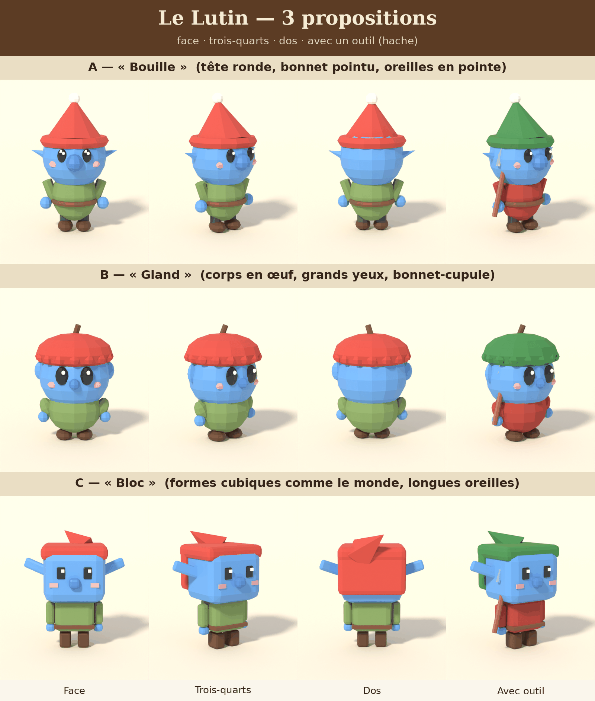
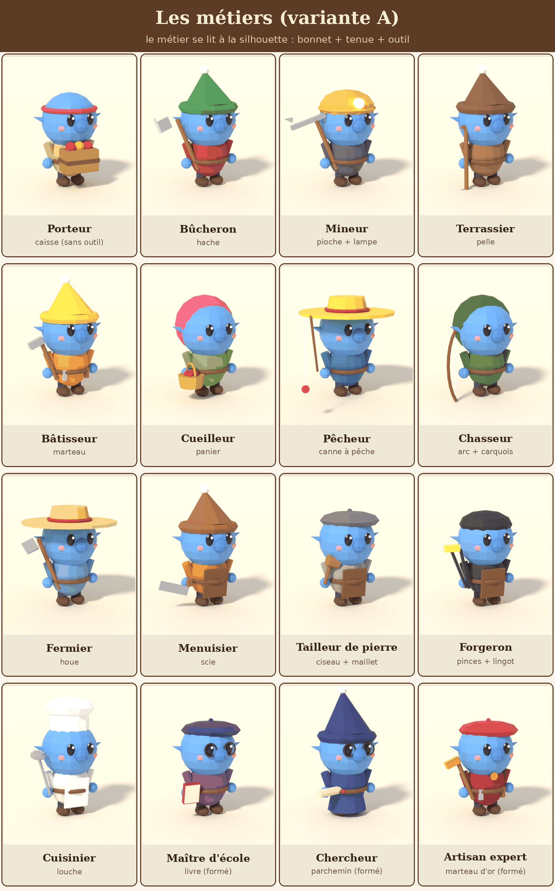
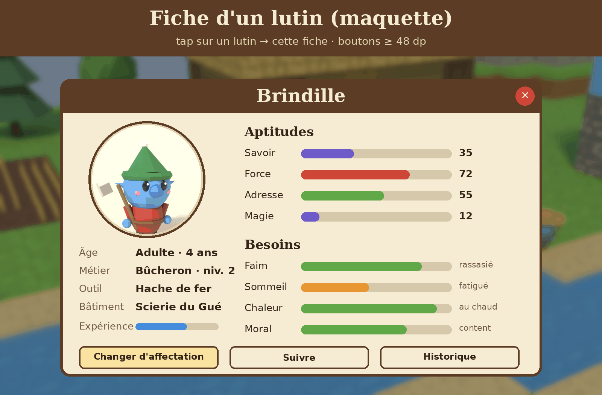
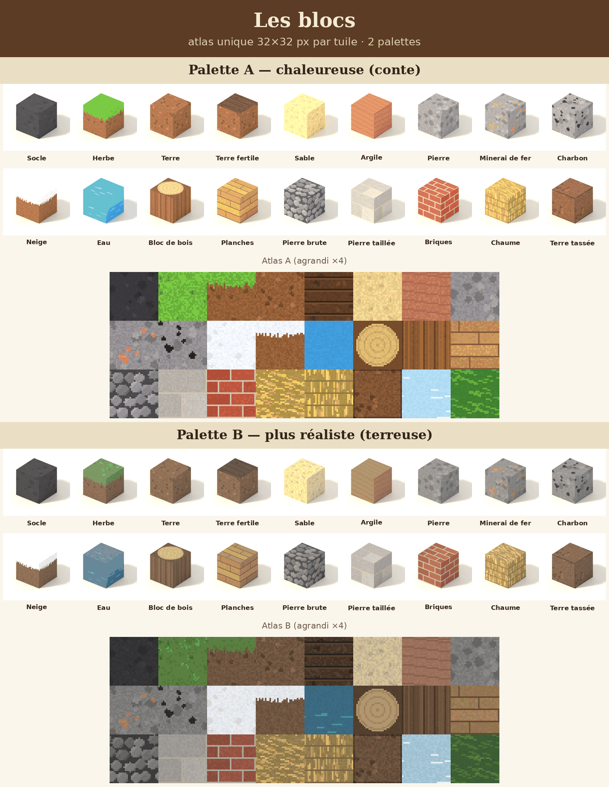
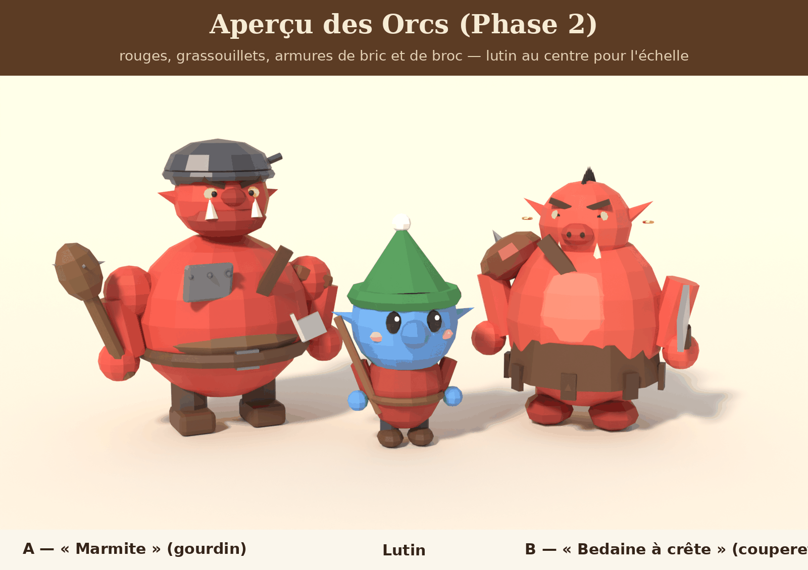

# Planches de style — à valider par Ashura

Tout est rendu dans **Blender** (modèles low-poly originaux faits par script) sauf la fiche et l'interface (maquettes 2D).
Régénérer : `tools/style/build_all.sh`.

## a. Le Lutin — 3 propositions

A « Bouille » : tête ronde, bonnet pointu, oreilles en pointe. B « Gland » : corps en œuf, grands yeux, bonnet-cupule. C « Bloc » : formes cubiques assorties au monde en blocs.
**Question : Lutin A, B ou C ?** (je recommande **A** : lisible de loin, le bonnet change par métier)

## b. Les métiers (variante A)

16 métiers : une couleur de bonnet + une tenue + un outil bien visible. Les 3 derniers (maître d'école, chercheur, artisan expert) sont formés, sans outil de base.
**Question : les métiers sont-ils reconnaissables ? Un à changer ?**

## c. Les âges

Bébé (petit, tétine), enfant (cartable, bretelles), adulte, ancien (barbe blanche, canne, peau plus pâle, dos voûté).
**Question : tailles et signes de l'âge OK ?**

## d. Fiche d'un lutin

Nom, âge, métier + niveau, outil, bâtiment affecté, expérience, aptitudes (savoir, force, adresse, magie), besoins (faim, sommeil, chaleur, moral).
**Question : rien ne manque ? Style « parchemin + bois » OK ?**

## e. Les blocs

Les 18 blocs de `data/blocks.json`, une seule texture-atlas en pixel art 32×32. Palette A chaleureuse (conte), palette B plus réaliste (terreuse).
**Question : palette A ou B ?**

## f. Scène du village

Vue plongeante du jeu : rivière, champ de blé, maison en blocs (chaume, planches, pierre taillée), mur en construction avec ses **blocs-plans bleus**, 8 lutins. En hiver : neige, rivière gelée, arbres nus.
**Question : ambiance et lisibilité OK ? Lutins assez visibles au zoom « village » ?**

## g. Écran principal

Paysage 20:9 : barre du haut (saison, vitesse, population, stocks, alerte), 5 menus en bas, curseur d'étage à droite, panneau d'affectation ouvert.
**Question : disposition OK ?**

## h. Orcs (bonus, Phase 2)

A « Marmite » : ventre rond, casque-marmite, gourdin. B « Bedaine à crête » : museau, crête, épaulière de récupération, couperet.
**Question : Orc A ou B (ou mélange) ?**
