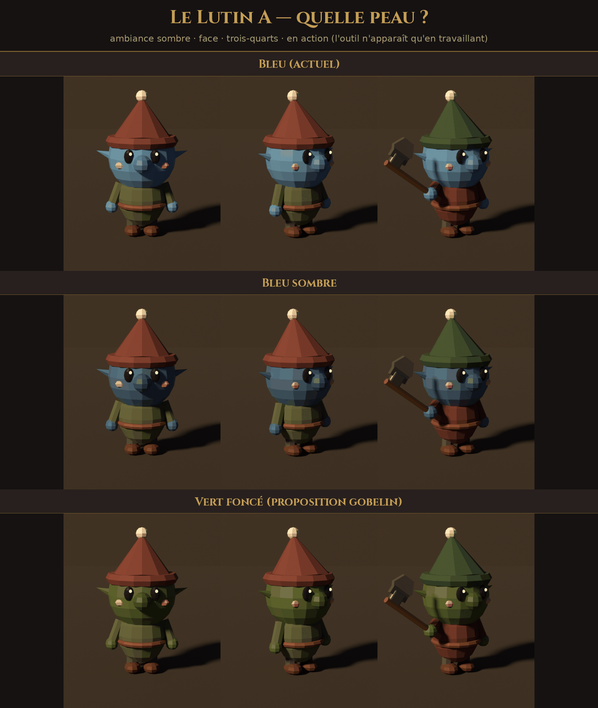
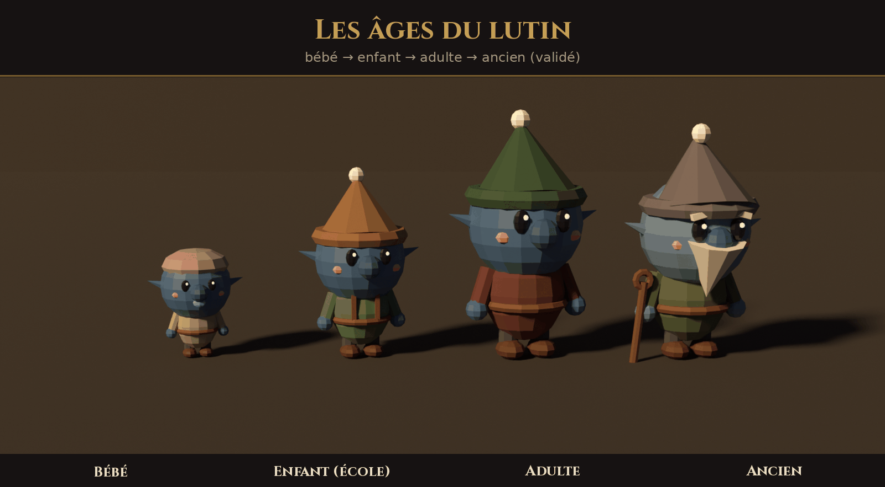
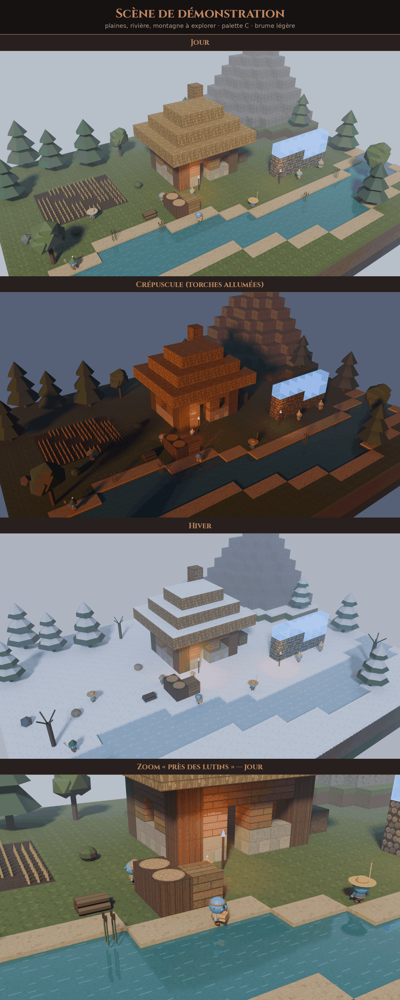
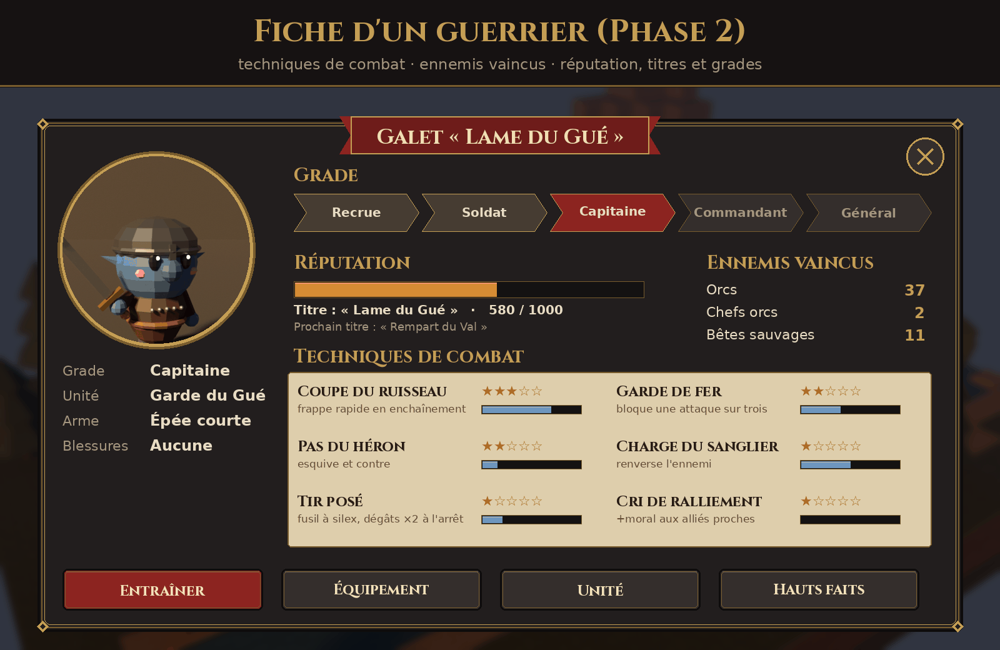
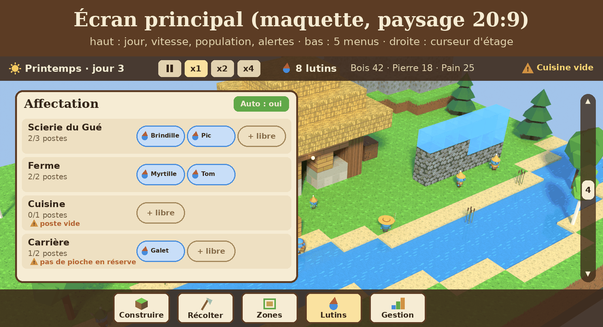
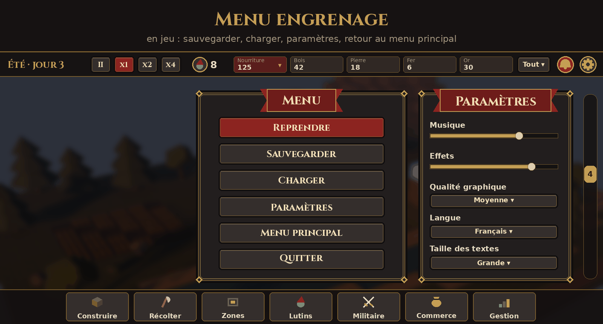
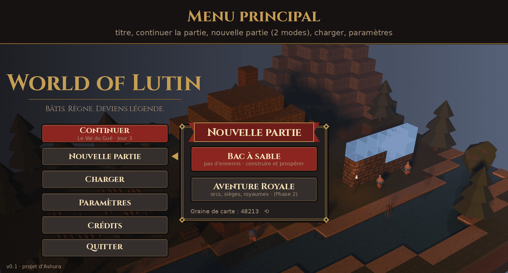

# Planches de style — version 2

Rendus 3D dans **Blender** (modèles faits par script), maquettes d'interface en 2D. Régénérer : `tools/style/build_all.sh`.

## Validé
- **Orc B « Bedaine à crête »** · **style d'interface** (fer sombre, boutons rouge et or, parchemin)
- **Peau bleu sombre** · **palette B** (la plus réaliste, pas trop sombre ; la C est écartée) · pas de magie.
- Lutin **A « Bouille »** ([planche v1](lutin-variantes.png)) · âges OK · palette **B** comme base, à rendre plus sombre.

## Retours v1 pris en compte
- Outil **seulement pendant l'action**, outils retravaillés ; chasseur au **fusil à silex**.
- Ambiance plus sombre et réaliste (dark fantasy médiéval), **avec une vraie journée** ; ton « murim » **sans magie spectaculaire**.
- Plaines + rivière gardées, **montagne à explorer** au fond.
- Fiche : métiers connus (niveau + XP gardés), cloche **Mobiliser / Se cacher**. Fiche de guerrier (Phase 2).
- Interface : ressources déroulantes, dialogues, boutons **Militaire** et **Commerce**, **engrenage**, menu principal, thème plus travaillé.

## a. Peau du lutin

Bleu actuel, bleu sombre, ou vert foncé façon gobelin (design restant original).
**Question : bleu, bleu sombre ou vert foncé ?**

## b. Métiers (repos / action)

Mains vides au repos ; l'outil apparaît pendant le travail.
**Question : outils plus lisibles maintenant ? Fusil du chasseur OK ?**

## c. Âges (ambiance sombre)

## d. Blocs

Palette B (réaliste) et nouvelle palette **C** (sombre, usée).
**Question : B ou C ?**

## e. Scène : jour, crépuscule, hiver

Brume légère, soleil voilé le jour, torches au crépuscule, montagne en fond.
**Question : ambiance OK ? Plus sombre / plus clair ?**

## f. Fiche d'un lutin

Métiers connus (niveau + expérience), cloche (Mobiliser / Se cacher), changement de métier.

## g. Fiche d'un guerrier (Phase 2)

Grades Recrue → Soldat → Capitaine → Commandant → Général, réputation et titres, ennemis vaincus, techniques de combat.

## h. Écran de jeu, menu engrenage, menu principal

**Question : ce style d'interface (fer sombre, filets dorés, parchemin) te plaît ?**

## i. Orcs (inchangé, v1)

**Question toujours ouverte : Orc A ou B ?**
